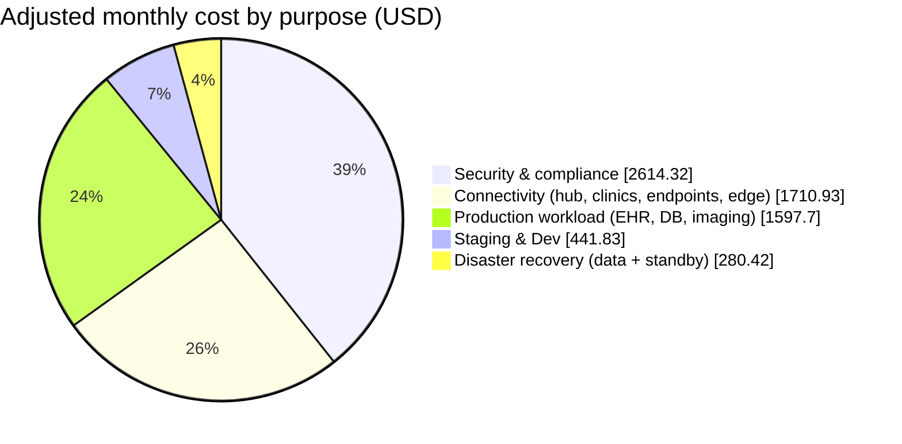

# 💲 Cost Estimate

**Bayou Clinic Partners · AWS Migration · Steady-state monthly run cost**

---

> ### 📌 The short version
> Running the full HIPAA-aligned design costs about **$6,645 a month (~$79,700 a year)**.
> The EHR itself is only about a quarter of that. **Most of the bill pays for protection and connectivity:** inspection, zero-trust access, threat detection, audit evidence, and the hub that links eight clinics. That is normal for a regulated healthcare workload, and every dollar of it is traceable to a design decision.

| | |
|---|---|
| 📄 **Calculator export (CSV)** | [`pricing-calculator-export.csv`](pricing-calculator-export.csv) |
| 📑 **Calculator estimate (PDF)** | [`pricing-calculator-estimate.pdf`](pricing-calculator-estimate.pdf) |
| 🔗 **Live estimate** | `<share link to be added>` |
| 🧭 **Design behind the numbers** | [Design Plan](../design-plan.md) |

## Contents

1. [Headline numbers](#-headline-numbers)
2. [Where the money goes](#-where-the-money-goes)
3. [Cost by account group](#-cost-by-account-group)
4. [The cost of security](#-the-cost-of-security)
5. [Line-item detail](#-line-item-detail)
6. [Manual adjustments](#-manual-adjustments)
7. [Assumptions](#-assumptions)
8. [Pricing models and why](#-pricing-models-and-why)
9. [Calculator traps caught](#-calculator-traps-caught)
10. [Optimization levers](#-optimization-levers)
11. [Outside the AWS bill](#-outside-the-aws-bill)
12. [Known record issues](#-known-record-issues)

---

## 🎯 Headline numbers

| | Monthly | Annual |
|---|---:|---:|
| AWS Pricing Calculator total | $6,348.00 | $76,176.00 |
| Manual adjustments (net) | +$297.20 | +$3,566.40 |
| **Adjusted AWS run cost** | **$6,645.20** | **$79,742.40** |
| Upfront cost | $0.00 | $0.00 |

**Scope:** steady-state year one, us-west-2 primary and us-east-1 DR, all eight accounts, no free tiers or trials. Migration (one-time) costs and non-AWS contracts are excluded and listed [separately](#-outside-the-aws-bill).

---

## 🥧 Where the money goes

| Purpose | Monthly | Share |
|---|---:|---:|
| 🛡️ Security & compliance | $2,614.32 | 39.3% |
| 🌐 Connectivity | $1,710.93 | 25.7% |
| 🏥 Production workload | $1,597.70 | 24.0% |
| 🧪 Staging & Dev | $441.83 | 6.6% |
| 🔁 Disaster recovery | $280.42 | 4.2% |
| **Total** | **$6,645.20** | **100%** |

> 💡 **Takeaway:** protection plus connectivity is **65%** of the bill. The application is the smallest major slice. Stakeholders who expect "cloud cost = servers" need this picture first.

---

## 🧾 Cost by account group

| Group | Accounts | Calculator | Adjustments | **Adjusted** | Services |
|---|---|---:|---:|---:|---:|
| 🌐 Network | Network | $2,588.67 | −$121.00 | **$2,467.67** | 3 |
| 🏥 Prod | Prod | $1,597.70 | — | **$1,597.70** | 7 |
| 🛡️ Security and Logging | Management, Log Archive, Audit | $1,029.83 | — | **$1,029.83** | 10 |
| 🚪 Edge | Prod (global) | $25.15 | +$413.20 | **$438.35** | 3 + 2 manual |
| 🧪 Staging and Development | Staging, Dev | $441.83 | — | **$441.83** | 8 |
| 🧩 Shared Services | Shared Services | $363.40 | — | **$363.40** | 2 |
| 🔁 DR | us-east-1 | $301.42 | +$5.00 | **$306.42** | 6 + 2 manual |
| **Total** | **8 accounts** | **$6,348.00** | **+$297.20** | **$6,645.20** | **39 + 4** |

---

## 🛡️ The cost of security

Every line below exists to prevent, detect, contain, or prove something. Shown on its own so leadership sees exactly what protection costs.

| Control | Monthly | What it buys |
|---|---:|---|
| AWS Network Firewall | $1,131.29 | Egress allow-list (no PHI exfiltration) and inspection of clinic and inter-VPC traffic |
| AWS Verified Access | $398.20 | Zero-trust remote EHR access: identity + device check on every request |
| Amazon GuardDuty (both regions) | $350.40 | Threat detection: compromised keys, crypto mining, DB brute force, runtime attacks |
| AWS Config (both regions) | $228.00 | Drift detection, HIPAA conformance pack, required-tags enforcement |
| Amazon CloudWatch | $153.04 | Alarms and searchable app, OS, and pgAudit logs |
| Amazon Security Lake | $91.22 | OCSF data lake feeding the SIEM and MDR provider |
| AWS Security Hub | $80.00 | One prioritized finding list across 8 accounts |
| Log Archive (S3) | $57.06 | Immutable 6-year audit evidence (Object Lock, compliance mode) |
| AWS Audit Manager | $55.00 | Continuous HIPAA evidence, organized by control |
| AWS WAF + Bot Control | $29.00 | Web attack filtering and credential-stuffing defense on the patient login |
| Amazon Inspector | $22.50 | CVE scanning on every EC2 instance |
| AWS CloudTrail | $10.00 | Record of every PHI access (data events) |
| Amazon Macie | $8.61 | Finds PHI stored where it isn't labeled |
| **Total** | **$2,614.32** | **39% of the bill** |

> ⚖️ **Context:** healthcare has had the highest average breach cost of any industry for over a decade. Two cheap lines carry outsized weight: **CloudTrail ($10)** proves who accessed PHI, and **Macie ($9)** verifies the data labels. Audit controls are not where the money goes. Inspection and detection are.

> 💸 **Built-in offset:** NAT gateways placed behind Network Firewall are billed at no charge hour-for-hour and GB-for-GB, so the firewall erases the **$121/month** NAT line.

---

## 📋 Line-item detail

<b>🏥 Prod · $1,597.70</b>

| Service | Configuration | Pricing | Monthly |
|---|---|---|---:|
| EC2 · EHR app servers | 3 × m7i.xlarge, 3 AZs, 100 GB gp3 each | Compute Savings Plan, 1 yr, no upfront | $348.36 |
| EC2 · HL7 interface engine | 2 × m7i.large active/passive, 200 GB gp3, daily snapshots | Compute Savings Plan, 1 yr | $163.13 |
| EC2 · OHIF image viewer | 3 × t3.small, 30 GB gp3 | Compute Savings Plan, 1 yr | $40.05 |
| Aurora PostgreSQL | 2 × db.r7g.large (writer + reader), I/O-Optimized, 500 GB, 500 GB backup | Reserved, 1 yr, no upfront | $607.19 |
| S3 Intelligent-Tiering | 5 TB clinical documents, 500 KB avg object | On-demand | $80.54 |
| S3 Glacier Deep Archive | 20 TB imaging archive copy (DR source), 10 MB avg object | On-demand | $23.21 |
| Data transfer | 250 GB/month replicated to us-east-1 | $0.02/GB (billed by sender) | $5.00 |
| AWS HealthImaging | 20 TB (10% frequent, 90% archive instant access) | On-demand | $330.22 |

<b>🌐 Network · $2,588.67 calculator · $2,467.67 adjusted</b>

| Service | Configuration | Monthly |
|---|---|---:|
| Transit Gateway | 16 attachments (5 VPC, 9 VPN, 1 DX gateway, 1 DR peering), 8,190 GB processed (includes inspection hairpin) | $747.84 |
| Site-to-Site VPN | 9 connections (7 clinics, flagship backup, VPN over DX), 24/7 | $328.50 |
| NAT Gateway | 3 zonal gateways, 500 GB processed | $121.08 → **$0** after waiver |
| AWS Network Firewall | 3 endpoints, 4 TB inspected | $1,131.29 |
| AWS Direct Connect | 1 Gbps, DataBank HOU3 (Houston), 2 TB out | $259.96 |

<b>🛡️ Security and Logging · $1,029.83</b>

| Service | Configuration | Monthly |
|---|---|---:|
| CloudWatch | 120 GB standard ingestion, 350 GB vended logs straight to S3, 50 alarms | $153.04 |
| S3 · Log Archive (year 1) | 0.5 TB Standard + 2.5 TB Glacier Instant Retrieval, 5 M PUTs | $57.06 |
| CloudTrail | Org trail (first copy free), 10 M data events | $10.00 |
| GuardDuty | 5 M mgmt events, 200 GB flow, 50 GB DNS, 8 M S3 events, RDS, EC2 runtime (40 vCPU) | $342.40 |
| Security Hub | 8 accounts × 10,000 checks, consolidated controls | $80.00 |
| Config | 20,000 CIs, 100,000 rule + 50,000 pack evaluations | $210.00 |
| Security Lake | 20 GB CloudTrail + 265 GB other AWS logs | $91.22 |
| Macie | 30 buckets, 15 M objects, sampling 5 TB | $8.61 |
| Audit Manager | 8 accounts × 50 resources × 110 evidence items | $55.00 |
| Inspector | 18 EC2 instances | $22.50 |

<b>🚪 Edge · $25.15 calculator · $438.35 adjusted</b>

| Service | Configuration | Monthly |
|---|---|---:|
| CloudFront | 50 GB to US patients, 5 M HTTPS requests, VPC origin (no extra charge) | $9.25 |
| WAF | 1 web ACL, 2 custom rate rules, 4 AWS managed groups, 5 M requests | $14.00 |
| Route 53 | 3 hosted zones, 1 M queries, 2 health checks (free tier, permanent) | $1.90 |
| *Bot Control (manual)* | *$10 subscription + 5 M requests × $1/M* | *$15.00* |
| *Verified Access (manual)* | *2 apps × 730 h × $0.27 + 200 GB × $0.02* | *$398.20* |

<b>🧩 Shared Services · $363.40</b>

| Service | Configuration | Monthly |
|---|---|---:|
| PrivateLink | 7 interface endpoints × 3 AZs, 2.5 TB processed | $178.90 |
| Route 53 Resolver | 2 inbound ENIs, 5 M queries | $184.50 |

<b>🔁 DR (us-east-1) · $301.42 calculator · $306.42 adjusted</b>

| Service | Configuration | Monthly |
|---|---|---:|
| Aurora Global secondary | **Headless**: 0 instances, 500 GB replicated storage (db.r7g.large launched at failover) | $112.50 |
| S3 Glacier Deep Archive | 20 TB imaging replica | $21.96 |
| AWS Backup · Aurora | 5 weekly copies, Vault Lock | $51.42 |
| AWS Backup · EBS | 330 GB golden AMI snapshots, 2 monthly | $16.50 |
| Transit Gateway (standby) | 2 attachments (DR VPC + peering); clinic VPNs built at failover | $73.04 |
| GuardDuty | Light volumes | $8.00 |
| Config | 1,000 CIs, 10,000 + 5,000 evaluations | $18.00 |
| *Aurora replication (manual)* | *100 GB × $0.02* | *$2.00* |
| *Backup copy transfer (manual)* | *150 GB × $0.02* | *$3.00* |

<b>🧪 Staging and Development · $441.83</b>

| Service | Configuration | Pricing | Monthly |
|---|---|---|---:|
| EC2 · Staging EHR | 3 × m7i.large | On-demand, 36% (business hours) | $79.47 |
| EC2 · Staging interface engine | 2 × m7i.large | On-demand, 36% | $52.98 |
| EC2 · Staging viewer | 3 × t3.small | On-demand, 36% | $16.40 |
| EC2 · Dev all-in-one | 3 × t3.medium | On-demand, 36% | $32.80 |
| Aurora · Staging | 2 × db.r7g.large, Standard, 200 GB | On-demand, 36% | $181.57 |
| Aurora · Dev | 1 × db.t4g.medium, Standard, 50 GB | On-demand, 36% | $24.71 |
| S3 Standard | 400 GB de-identified + synthetic data | On-demand | $9.90 |
| EBS | 11 × 50 GB gp3, **billed 24/7** | On-demand | $44.00 |

---

## 🛠️ Manual adjustments

The calculator doesn't model everything. Each adjustment is sourced and documented.

| # | Adjustment | Amount | Why | Source |
|---|---|---:|---|---|
| 1 | NAT gateway waiver | −$121.00 | NAT behind Network Firewall is free hour-for-hour and GB-for-GB; calculator doesn't apply it | AWS Network Firewall pricing page |
| 2 | WAF Bot Control (Common) | +$15.00 | Not modeled in the WAF form | AWS WAF pricing page |
| 3 | AWS Verified Access | +$398.20 | Service not in the calculator | AWS Verified Access pricing page |
| 4 | Aurora Global replication | +$2.00 | Aurora form has no cross-region transfer field | EC2 inter-region transfer rate |
| 5 | DR backup copy transfer | +$3.00 | Backup form has no transfer field | EC2 inter-region transfer rate |
| | **Net** | **+$297.20** | | |

---

## 📐 Assumptions

| # | Assumption | Value |
|---|---|---|
| 1 | Peak concurrent EHR users | 250 of 400 staff |
| 2 | EHR app servers (Prod) | 3 × m7i.xlarge, Linux |
| 3 | Interface engine | 2 × m7i.large |
| 4 | Aurora | db.r7g.large (Graviton is fine for managed Aurora; vendor certifies the engine, not the CPU) |
| 5 | EHR database size | 500 GB, +10%/year, 0.5% daily change |
| 6 | Clinical documents | 5 TB, +1 TB/year, 500 KB average |
| 7 | Imaging archive | 20 TB, +3 TB/year, ~10 MB per DICOM object |
| 8 | Transit Gateway / firewall traffic | 4 TB/month, all inspected (hairpin counted twice at TGW) |
| 9 | Staging and Dev | Business hours, 264 h/month (12 h × 22 days) |
| 10 | OHIF viewer | 3 × t3.small (one per AZ) |
| 11 | Image viewing egress | 2 TB/month, mostly flagship over Direct Connect |
| 12 | Log volume | 500 GB/month (200 flow, 100 firewall, 50 DNS, 30 access, 100 app/OS/pgAudit, 20 CloudTrail) |
| 13 | Patient portal | 50 GB/month, 5 M requests |
| 14 | Verified Access | 2 apps (EHR, viewer), 200 GB/month |
| 15 | Aurora cross-region replication | 100 GB/month |
| 16 | Backup copies to DR | 150 GB/month |
| 17 | Non-prod sizing | Staging half-size, same 3-AZ shape; Dev 3 × t3.medium |
| 18 | Non-prod databases | Staging writer + reader, Dev writer only, Aurora Standard |

Scenario assumptions: Linux EHR certified on PostgreSQL; clinic runs Microsoft 365 (Entra ID); one flagship clinic with Direct Connect in Houston.

---

## 🏷️ Pricing models and why

| Workload | Model | Reason |
|---|---|---|
| Prod EC2 baseline | **Compute Savings Plan, 1 yr, no upfront** | Never turns off. Applies across regions and families, so it still covers servers rebuilt in us-east-1 during DR or resized after year one. ~27% off on-demand |
| Prod Aurora | **Reserved, 1 yr, no upfront** | Database discounts are separate from Compute Savings Plans |
| Peaks above baseline | On-demand | Scheduled scaling adds capacity only during clinic hours |
| Staging and Dev | On-demand × hours used | A commitment bills 730 h whether servers run or not |
| Why not 3-year | — | Commit after measuring. A wrong 3-year commitment is three years of waste |
| Why not Spot | — | Spot can be reclaimed with 2 minutes' notice. Never for an EHR |

---

## 🪤 Calculator traps caught

Every default below favored spending more. Catching them is the difference between an estimate and a guess.

| Trap | What the calculator did | Fix | Impact |
|---|---|---|---:|
| Default object size | 16 MB average on 5 TB of documents | 500 KB | ~30× monitoring fee undercount avoided |
| Direct Connect port | 10 Gbps default | 1 Gbps | ~$1,400/month avoided |
| Per-attachment TGW data | 4 TB entered per attachment = 60 TB | Total ÷ attachments | ~$1,200/month avoided |
| Percent vs. amount | HealthImaging tier fields read as TB | Total + % split | Form error |
| Units | GuardDuty events defaulted to single events, not millions | Explicit units | Undercount avoided |
| Alternatives in one form | Regional NAT, Client VPN, EKS runtime, Serverless ACUs | Fill only the designed option | Double-count avoided |
| RDS Proxy default "Yes" | Silent proxy charge on Aurora | Set to No | Hidden charge removed |
| Oversized default instance | db.r5.12xlarge on headless DR Aurora | db.r7g.large (record accuracy) | $0, but honest record |
| EFS Backup default on | Backups for a service not in the design | Toggle off | Phantom charge avoided |
| Cross-region transfer | Priced on the receiving side ($0) | Billed by the sending region | $5 captured correctly |
| Full-copy backups | 35 daily DR Aurora copies = $367 | 5 weekly copies | ~$316/month saved |
| Scheduled EBS | Disk cost scaled to 36% with compute | Separate 24/7 EBS line | Undercount fixed |
| Snapshot default "2x Daily" | Snapshots on disposable non-prod disks | No snapshots | ~$77/month avoided |
| Free trials | 30-day and 2-month trial banners | Priced steady-state | No month-3 surprise |

---

## 🎚️ Optimization levers

Ranked by effort versus savings. None are in the estimate; each is a tested, reversible option.

| Lever | Est. savings | Trade-off |
|---|---:|---|
| Exempt large imaging uploads from deep inspection | ~$40–$80/mo | Imaging traffic still encrypted and logged, but not deeply inspected |
| Bot Control scoped to the login page only | ~$4/mo | Fewer false positives too |
| 3-year commitments after year one | ~$150–$250/mo | Lock-in once usage is measured |
| Graviton for EHR servers (if vendor certifies ARM) | ~$70/mo | Requires vendor support |
| Shorter CloudWatch retention / Infrequent Access log class | ~$20–$40/mo | Slower searches on older logs |
| Batch and compress logs before archiving | ~$25/mo | Fewer, larger objects cut PUT and transition fees |
| Consolidate interface endpoints by usage | ~$20–$50/mo | Some API traffic returns to the egress path |

---

## 🧾 Outside the AWS bill

| Item | Type | Notes |
|---|---|---|
| Carrier circuit: flagship clinic → DataBank HOU3 | Monthly, recurring | Quote from a Direct Connect partner |
| MDR provider + SIEM licensing | Monthly, recurring | Vendor contract; BAA required |
| EDR agents (e.g., SentinelOne) | Per endpoint, recurring | Covers EC2 fleet |
| Vendor EHR license and support | Annual | Unchanged by migration |
| DICOM router appliances (8 clinics) | One-time + support | Hardware at each clinic |
| Migration services (DMS, MGN, DataSync runtime) | One-time | Covered in the migration plan |
| Historical imaging replication (S3 Batch Replication) | One-time | 20 TB backfill to us-east-1 |

---

## 📝 Known record issues

Cosmetic only. No effect on totals.

| Line | Issue |
|---|---|
| Security and Logging · CloudWatch | Description blank in the calculator |
| Prod · HealthImaging | Metadata fields still show default 200 MB / 150 SOP (actual design: 50 MB / 5); metadata cost is negligible |
| DR · GuardDuty | S3 data events omitted (~$0.40) |
| PDF export | Estimate URL blank; exported before the estimate was shared |
| Direct Connect | Priced as a dedicated 1 Gbps port; design uses a hosted connection via a carrier partner at similar cost |
| Staging and Dev Aurora | Priced as provisioned at 36% because the calculator lacks Serverless v2 for Aurora PostgreSQL; design uses Serverless v2 |

---

*Prices from the AWS Pricing Calculator, exported November 3, 2026. All figures USD, steady state, before taxes.*

