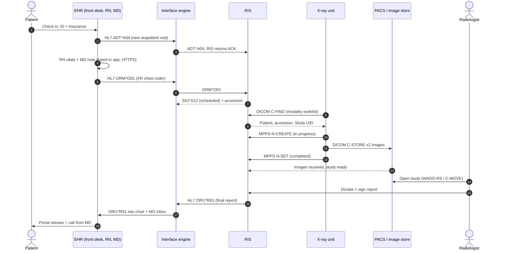

# Healthcare Data Flow Primer: HL7, DICOM, PACS

Reference for the Bayou Clinic Partners design. It follows one outpatient chest X-ray from check-in to the final report and back to the ordering doctor, and lists the system, message format, encryption, and storage at each step. All patients, staff, and numbers are fictional.

Legend: **app** = a person typing into an application, **HL7** = HL7 v2 text message over MLLP, **DICOM** = images over DIMSE, **HTTPS** = DICOMweb, FHIR, or web apps.

## 1. Terms

**HL7 v2.** Health Level Seven version 2. The workhorse standard for sending **text events** between hospital systems: patient registered, order placed, result ready. A message is lines called **segments** (MSH, PID, PV1, ORC, OBR, OBX), split into fields by `|` and components by `^`. Version 2.3 to 2.5.1 is what most clinics run. Not human-friendly, but almost every EHR, lab and RIS speaks it.

**MLLP.** Minimal Lower Layer Protocol. How HL7 v2 rides on a plain TCP socket: a start byte `0x0B`, the message, then `0x1C 0x0D`. The receiver sends back an **ACK**. Port is whatever the two sides agree on (2575 is the registered one). MLLP has no encryption of its own. You wrap it in TLS or send it through a VPN.

**FHIR.** Fast Healthcare Interoperability Resources, also from HL7. The modern version: **resources** (Patient, Encounter, ServiceRequest, ImagingStudy, DiagnosticReport) as JSON, read and written over HTTPS with OAuth 2.0 tokens. Patient apps and the 21st Century Cures Act APIs use it. Inside the building HL7 v2 still does most of the work. FHIR is used more at the edges: apps, portals, payers, cloud stores.

**DICOM.** Digital Imaging and Communications in Medicine. Two things in one: a **file format** (pixels plus a header of tagged attributes like `(0010,0010) PatientName`) and a **network protocol** (DIMSE) for sending, finding and moving images between devices called **AEs** (application entities). Every image from CT, MRI, X-ray, ultrasound and mammography is DICOM.

**DIMSE services.** The DICOM commands: `C-ECHO` (ping), `C-STORE` (send an image), `C-FIND` (search, also used for the worklist), `C-MOVE`/`C-GET` (retrieve), `N-CREATE`/`N-SET` (MPPS status). They run inside an **association**, a negotiated session between two AE titles. Ports 104 or 11112; 2762 for DICOM over TLS.

**DICOMweb.** DICOM over REST. **STOW-RS** stores (HTTP POST), **QIDO-RS** searches (GET with query), **WADO-RS** retrieves (GET). Same DICOM objects, carried over HTTPS so TLS encryption comes built in. Cloud image stores and web viewers use this.

**Medical record.** The **legal record of care**: notes, vitals, orders, results, images, reports, consents. It is a concept, not a product. It has to be kept for years (state law sets how long), and patients have a HIPAA right to a copy.

**EMR vs EHR.** **EMR** (electronic medical record) is the digital chart inside one practice. **EHR** (electronic health record) is built to share that chart across organizations. People use the terms loosely; products like Epic, Oracle Health (Cerner), athenaOne and eClinicalWorks are sold as EHRs.

**HIS.** Hospital Information System. The umbrella for the business side: registration and ADT (admit/discharge/transfer), scheduling, billing, bed management. In most modern setups the EHR *is* the HIS, as modules of one product.

**RIS.** Radiology Information System. Runs the **radiology workflow** (not the pixels): receives orders, assigns the accession number, schedules rooms, publishes the modality worklist, tracks exam status, holds the report, sends charges. Often a module of the EHR (for example Epic Radiant).

**PACS.** Picture Archiving and Communication System. Receives DICOM images, stores them, and serves them to diagnostic viewers. A **VNA** (vendor neutral archive) is a long-term store behind one or more PACS so images outlive any one vendor.

**Worklist(s).** **Modality worklist (MWL)**: the RIS's list of scheduled exams that the X-ray machine pulls with a DICOM C-FIND, so the tech picks the patient instead of typing. **Reading worklist**: the radiologist's queue of finished studies waiting for a report, inside PACS or the reading platform.

**MPPS.** Modality Performed Procedure Step. The machine tells the RIS "exam started" (N-CREATE, IN PROGRESS) and "exam done" (N-SET, COMPLETED or DISCONTINUED), with the list of series it made.

**Interface engine.** Middleware that receives, translates and routes HL7 (and often FHIR) between systems: Mirth Connect, Rhapsody, InterSystems, Cloverleaf. It queues messages when a system is down and keeps a log of every message.

**IHE profiles.** Integrating the Healthcare Enterprise writes "recipes" for how HL7 and DICOM fit together. **SWF** (Scheduled Workflow) is basically this whole page. **ATNA** covers audit logs and node authentication. **PIR** covers fixing patient info after the fact.

## 2. Numbers and IDs

There isn't one "session number." Each step creates its own identifier, and the systems link records by passing them along.

| ID | Example | Who creates it | Identifies | Where it appears |
|---|---|---|---|---|
| **MRN** (medical record number) | `MRN100245` | EHR / master patient index | The patient, for life, inside this organization | HL7 `PID-3`, DICOM `(0010,0020)`, FHIR Patient.id |
| **Visit / encounter number** (also FIN or CSN) | `V20261027-0042` | EHR registration | This one visit. Billing hangs off it | HL7 `PV1-19`; account number in `PID-18` |
| **Placer order number** | `ORD445566` | EHR, when the doctor signs the order | The order as the ordering system knows it | HL7 `ORC-2`, `OBR-2` |
| **Accession number** | `ACC2610270042` | RIS (the filler) | This one imaging exam. The key that joins order, images and report | HL7 `ORC-3`/`OBR-3`/`OBR-18`, DICOM `(0008,0050)` |
| **Study Instance UID** | `2.25.2922…34640` | RIS (via worklist) or the modality | The image study, globally unique | DICOM `(0020,000D)`; FHIR ImagingStudy |
| **Series / SOP Instance UIDs** | `2.25.2247…70252` | The modality | Each series (PA, LAT) and each single image | DICOM `(0020,000E)`, `(0008,0018)` |
| **HL7 message control ID** | `MSG00002` | Sending system | One message, so the ACK can say "got MSG00002" | HL7 `MSH-10`, echoed in `MSA-2` |
| **AE title** | `BCPN_DX1` | IT / PACS admin | A DICOM device, like a hostname | Association request; worklist filter |

For network sessions: HL7 uses a long-lived TCP connection per interface, DICOM opens an association per batch of images, and web apps use a login session or OAuth token.

## 3. The chain, step by step

### Step 1. Check-in and registration

*Front desk · patient* · app, HL7

| | |
|---|---|
| Systems | EHR registration (HIS module). Insurance check by X12 270/271 to the payer. |
| Created | Finds or creates the MRN, opens visit V20261027-0042, scans ID and consents. |
| Transfer | Saving the visit fires `ADT^A04` (outpatient registered) through the interface engine to RIS, lab and billing so they all know the patient. |
| Encryption | Front desk screen over HTTPS. ADT over MLLP inside the network or VPN. |
| Stored in | EHR database; consents as scanned PDFs in document management. |

Examples: [Face sheet](#ex-registration), [HL7 ADT^A04](#ex-adt), [HL7 ACK](#ex-ack)

### Step 2. Nurse intake

*RN or medical assistant* · app

| | |
|---|---|
| Systems | EHR flowsheets. Vitals monitor may auto-file readings. |
| Created | Vitals, allergies, med reconciliation, chief complaint, pregnancy screen. |
| Transfer | Nothing leaves the EHR yet. The data is in the chart for the doctor and later the radiologist. |
| Encryption | EHR app over HTTPS; the device feed is often HL7 ORU from the monitor. |
| Stored in | EHR flowsheet tables, each value time-stamped and signed. |

Examples: [Nurse flowsheet](#ex-nurse)

### Step 3. Doctor exam and imaging order

*Ordering physician* · app, HL7

| | |
|---|---|
| Systems | EHR notes + CPOE (computerized provider order entry). |
| Created | SOAP note, diagnosis (ICD-10 R05.9), order for XR chest 2 views (CPT 71046). |
| Transfer | Signing the order sends `ORM^O01` (or `OMI^O23` in newer HL7) to the RIS. This is the placer order ORD445566. |
| Encryption | MLLP behind TLS or VPN. |
| Stored in | EHR note and order tables. |

Examples: [MD note + order](#ex-physician), [HL7 ORM^O01](#ex-orm), [MLLP framing](#ex-mllp)

### Step 4. RIS schedules and builds the worklist

*RIS / radiology scheduler* · HL7, DICOM

| | |
|---|---|
| Systems | RIS (stand-alone or the EHR's radiology module). |
| Created | Assigns accession ACC2610270042 and a Study Instance UID, books North XR1 at 09:45. |
| Transfer | Sends `SIU^S12` back to the EHR so the visit shows the appointment, and adds the exam to the modality worklist. |
| Encryption | MLLP for SIU; worklist served as DICOM. |
| Stored in | RIS schedule and exam tables. |

Examples: [HL7 SIU^S12](#ex-siu), [RIS exam record](#ex-ris)

### Step 5. Tech pulls the worklist and scans

*Radiologic technologist (RT)* · DICOM, app

| | |
|---|---|
| Systems | X-ray unit console (modality), RIS. |
| Created | Machine runs a worklist `C-FIND`, tech picks Marie, checks two identifiers and pregnancy status, takes PA and lateral. |
| Transfer | MPPS `N-CREATE` tells the RIS the exam started; `N-SET` says it's completed. Tech notes go in the RIS exam record. |
| Encryption | DIMSE on the clinic LAN (often unencrypted inside; TLS if the unit supports it). |
| Stored in | Images briefly on the modality's disk; tech data in RIS. |

Examples: [Worklist C-FIND](#ex-mwl), [MPPS](#ex-mpps)

### Step 6. Images go to PACS

*Modality → router → PACS* · DICOM, HTTPS

| | |
|---|---|
| Systems | DICOM router at the clinic, PACS or cloud image store. |
| Created | Two DICOM files, each carrying MRN, accession and UIDs in the header. |
| Transfer | Modality opens an association and sends `C-STORE`. For a cloud store the router re-sends with DICOMweb `STOW-RS` over HTTPS. Storage commitment confirms the archive has them, then the modality can delete its copy. |
| Encryption | LAN DIMSE, then TLS (HTTPS) and/or IPsec VPN to the data center or cloud. |
| Stored in | PACS / VNA, encrypted at rest, indexed by patient, study, series, instance. |

Examples: [DICOM association](#ex-assoc), [DICOM header](#ex-dicom), [DICOMweb](#ex-stow)

### Step 7. Study lands on the reading worklist

*PACS / RIS* · DICOM, HL7

| | |
|---|---|
| Systems | PACS, RIS, reading platform. |
| Created | PACS matches images to the order by accession. Tech marks QC done. Prior exams are pre-fetched. |
| Transfer | Exam status goes to Completed; the study appears in the radiologist's Chest - Routine queue. |
| Encryption | Internal; sometimes an HL7 status message. |
| Stored in | PACS database and RIS status log. |

Examples: [RIS exam record](#ex-ris)

### Step 8. Radiologist reads and reports

*Radiologist (often remote)* · HTTPS, DICOM, app

| | |
|---|---|
| Systems | Diagnostic viewer (PACS), speech recognition dictation, RIS. |
| Created | Opens the study, compares priors, dictates findings and impression, signs. |
| Transfer | Viewer pulls pixels by `WADO-RS` or `C-MOVE`. A critical finding would require a phone call to the ordering doctor, documented in the report. |
| Encryption | Remote readers come in over VPN or an HTTPS zero-footprint viewer with MFA. |
| Stored in | Report in RIS; optional DICOM SR/PDF copy in PACS. |

Examples: [Radiology report](#ex-report), [FHIR resources](#ex-fhir)

### Step 9. Report goes back to the chart

*RIS → interface engine → EHR* · HL7, HTTPS

| | |
|---|---|
| Systems | Interface engine, EHR. |
| Created | Final report text with status F. |
| Transfer | RIS sends `ORU^R01`. The EHR files it against order ORD445566, drops it in Dr. Landry's inbox, and adds an image link that launches the viewer. |
| Encryption | MLLP behind TLS/VPN; image launch over HTTPS. |
| Stored in | EHR results tables (a copy of the RIS report). |

Examples: [HL7 ORU^R01](#ex-oru), [EHR inbox](#ex-inbox)

### Step 10. Doctor acts, patient is told, claim goes out

*Ordering physician · patient · billing* · app, HTTPS

| | |
|---|---|
| Systems | EHR inbox, patient portal, billing system. |
| Created | Acknowledges result, prescribes, orders follow-up, messages patient. |
| Transfer | Portal shows the report (Cures Act information-blocking rules push for fast release). Charges go out as HL7 `DFT^P03`, then an X12 837 claim to the insurer. |
| Encryption | Portal and e-Rx over HTTPS. |
| Stored in | EHR, portal, billing system; every access logged. |

Examples: [EHR inbox](#ex-inbox), [Audit trail](#ex-audit)

## 4. Sequence diagram



## 5. Encryption

| Data / protocol | Encrypted by itself? | In transit, how it's protected | At rest |
|---|---|---|---|
| HL7 v2 over MLLP | No. Plain text, anyone sniffing the LAN can read names and diagnoses | TLS-wrapped MLLP, or an IPsec VPN between sites; inside the data center, segmented VLANs | Interface engine message store and logs on encrypted disk or database |
| DICOM DIMSE (port 104/11112) | No, unless DICOM TLS is configured (port 2762) | DICOM TLS (PS3.15 secure transport profile) or VPN. Many older modalities can't do TLS, so a router at the clinic re-sends securely | PACS/VNA storage encrypted (AES-256); modality local disk usually purged after send |
| DICOMweb | Yes, HTTPS (TLS 1.2+) | TLS plus auth on every request (OAuth token, or AWS SigV4 for AWS services) | Cloud store encrypted with keys you control (KMS) |
| FHIR API | Yes, HTTPS | TLS plus OAuth 2.0 / SMART on FHIR scopes (what the app may read) | FHIR server database encrypted |
| EHR screens (RN, MD, front desk) | Yes, HTTPS or Citrix/remote app (encrypted) | TLS; SSO with MFA; session timeouts on shared workstations; badge tap-in | EHR database with transparent data encryption; encrypted backups |
| Clinic Wi-Fi / devices | Depends | WPA2/WPA3-Enterprise (802.1X), separate SSID/VLAN for medical devices | BitLocker/FileVault on laptops; MDM on tablets |
| Images on CD / USB for patient | Usually not | Handed over in person | DICOMDIR + viewer on disc. Cloud image sharing links are replacing CDs |

HIPAA's Security Rule currently lists encryption as "addressable": you must do it or document why an equal alternative is in place. HHS proposed in 2025 to make it required; check the rule's current status before you cite it in the presentation. In practice, unencrypted PHI that leaks counts as a reportable breach, while properly encrypted data generally doesn't.

## 6. Where each person's records end up

| Who | What they record | System | Stored as |
|---|---|---|---|
| Front desk | Demographics, insurance, consents, photo ID | EHR registration / HIS | Database rows; scanned consents in document management (PDF/TIFF) |
| Nurse (RN/MA) | Vitals, allergies, meds, intake questions, pregnancy screen | EHR flowsheets | Structured rows (one per measurement, time-stamped, signed) |
| Doctor (ordering) | Progress note, diagnosis codes, orders, prescriptions | EHR notes + CPOE (computerized provider order entry) | Note text + structured order; e-prescriptions via NCPDP SCRIPT |
| Radiology scheduler | Exam slot, room, prep instructions | RIS | Schedule rows; SIU messages to EHR |
| Rad tech (RT) | ID check, pregnancy status, views taken, repeats, exposure/dose, tech notes, QC | RIS exam record + the modality | RIS rows; dose info in DICOM headers or dose reports; images to PACS |
| Modality | The images | X-ray / CT / US unit | DICOM Part 10 files, held only until PACS confirms storage |
| PACS / VNA | All images and prior studies | PACS, archive | DICOM objects on encrypted storage, indexed by MRN, accession, UIDs |
| Radiologist | The report, critical-result calls, addenda | Speech recognition (dictation) + RIS | Report text in RIS, copied to EHR by ORU; sometimes also DICOM SR or PDF in PACS |
| Doctor (follow-up) | Result acknowledgment, plan, patient message | EHR inbox + portal | Inbox actions, new note, portal message |
| Billing / coding | CPT + ICD-10 codes, charges, claim | Billing system | HL7 DFT charge messages; X12 837 claim to the payer |
| Everyone | Who looked at or changed what | Every system | Audit logs, commonly kept 6 years to match HIPAA's documentation retention period |

## 7. Examples

### Chart records (what people see on screen)

<a id="ex-registration"></a>

#### Face sheet (step 1)

What the front desk enters. The MRN and visit number created here follow the patient through every later message.

```
BAYOU CLINIC PARTNERS - NORTH CLINIC          REGISTRATION / FACE SHEET
---------------------------------------------------------------------------
Patient:        THIBODEAUX, MARIE L           MRN:        MRN100245
DOB:            03/14/1978  (48 y)            Sex:        F
Address:        1200 Plank Rd, Baton Rouge, LA 70805
Phone:          (225) 555-0142
Visit #:        V20261027-0042                Account #:  ACCT-55501
Visit type:     Outpatient - Same-day sick    Arrived:    10/27/2026 08:15
Provider:       Paul Landry, MD               Location:   North Clinic, Exam 3
Insurance:      Example Health Plan (PPO)     Member ID:  <REDACTED>
Eligibility:    Active (X12 270/271 checked 08:14)
Consents:       General consent signed (scanned to document mgmt)
                Notice of Privacy Practices acknowledged
Photo ID:       Verified by front desk (J. Hebert)
---------------------------------------------------------------------------
Created in: EHR registration module  ->  fires HL7 ADT^A04 to RIS, labs, billing
```

<a id="ex-nurse"></a>

#### Nurse flowsheet (step 2)

Structured nursing data. The radiologist may look at the pregnancy screen and history; the doctor uses vitals and allergies.

```
NURSING INTAKE - FLOWSHEET                     10/27/2026 08:31  Exam 3
Patient: THIBODEAUX, MARIE L   MRN100245   Visit V20261027-0042
Identity check: Name + DOB confirmed verbally (2 identifiers)
---------------------------------------------------------------------------
Chief complaint:  "Cough for about 10 days, fever on and off"
Vitals            BP 128/82   HR 88   Temp 100.2 F (oral)   RR 18
                  SpO2 96% RA   Wt 152 lb   Ht 5'5"   Pain 3/10 (chest, w/ cough)
Allergies         Penicillin - hives (reviewed, unchanged)
Home meds         Lisinopril 10 mg PO daily (reconciled)
LMP / pregnancy   Asked; patient reports not pregnant (needed before X-ray)
Smoking           Never
Fall risk         Low
---------------------------------------------------------------------------
Documented by: R. Guidry, RN       Device: vitals monitor -> EHR (auto-filed)
Stored in: EHR flowsheet tables (structured rows, one per measurement)
```

<a id="ex-physician"></a>

#### MD note + order (step 3)

The doctor's note and the order screen. Signing the order is the trigger for the HL7 order message.

```
PROGRESS NOTE (SOAP)                          10/27/2026 09:22
Patient: THIBODEAUX, MARIE L   MRN100245   Visit V20261027-0042
Author: Paul Landry, MD
---------------------------------------------------------------------------
S: 48F, 10 days productive cough, intermittent fever to 101, mild pleuritic
   pain R side. No hemoptysis. No sick contacts known.
O: T 100.2  HR 88  SpO2 96% RA. Crackles R base. No wheeze.
A: Suspected community-acquired pneumonia, R lower lobe.  ICD-10 R05.9
P: 1. XR chest 2 views (PA/lat) today - ORDERED
   2. Will decide antibiotics after imaging (PCN allergy noted)
   3. Return precautions given
---------------------------------------------------------------------------
CPOE ORDER                                     Order #: ORD445566
  Procedure:  XR CHEST 2 VIEWS (CPT 71046)     Priority: Routine (same day)
  Reason:     Cough, fever, crackles R base    Dx: R05.9
  Performing: North Clinic X-ray room 1
  Signed:     Paul Landry, MD  09:30:12   -> HL7 ORM^O01 sent to RIS
```

<a id="ex-ris"></a>

#### RIS exam record (step 4)

The RIS view of the exam: status timeline, tech documentation, link to images, billing trigger.

```
RIS EXAM RECORD                                 Accession: ACC2610270042
---------------------------------------------------------------------------
Patient     THIBODEAUX, MARIE L     MRN100245     Visit V20261027-0042
Order       ORD445566 (from EHR)    XR CHEST 2 VIEWS  CPT 71046   Routine
Ordering    Paul Landry, MD         Reason: cough, fever, crackles R base
Scheduled   10/27/2026 09:45        Room: North XR1   Station AE: BCPN_DX1
Status log  09:30 Ordered  09:31 Scheduled  09:51 Started (MPPS)
            09:54 Completed (MPPS)  09:58 Images verified (QC)
            10:48 Final report signed
Tech        D. Arceneaux, RT(R)
  ID check  Name + DOB vs wristband/verbal - OK
  Pregnancy Patient denies - documented
  Views     PA, LAT    Repeats: 0    Exposure index within range
  Shielding Per department protocol
  Tech note "Pt coughing, needed 2 attempts at full inspiration for PA."
Images      2 series / 2 instances sent to PACS  (storage commit OK)
Reading     Queue: Chest - Routine      Read by: Anne Boudreaux, MD
Billing     Technical charge CPT 71046 -> HL7 DFT^P03 to billing system
---------------------------------------------------------------------------
The RIS holds the workflow facts about the exam. The pixels live in PACS.
```

<a id="ex-report"></a>

#### Radiology report (step 8)

What the radiologist signs. Findings describe, impression concludes. This text becomes the OBX lines in the ORU.

```
RADIOLOGY REPORT - FINAL
---------------------------------------------------------------------------
Patient:   THIBODEAUX, MARIE L     MRN: MRN100245     DOB: 03/14/1978
Accession: ACC2610270042           Exam date: 10/27/2026 09:52
Ordering:  Paul Landry, MD         Location: North Clinic

EXAM:        XR chest, PA and lateral (2 views)
HISTORY:     Cough x 10 days, low-grade fever. Crackles right base.
COMPARISON:  None available.
TECHNIQUE:   PA and lateral views of the chest.

FINDINGS:
  Lungs: Patchy airspace opacity in the right lower lobe.
  Pleura: No pleural effusion. No pneumothorax.
  Heart/mediastinum: Normal cardiomediastinal silhouette.
  Bones: No acute osseous abnormality.

IMPRESSION:
  1. Right lower lobe opacity, compatible with pneumonia in the
     appropriate clinical setting.
  2. Recommend follow-up radiograph 6-8 weeks after treatment to
     document resolution.

Electronically signed: Anne Boudreaux, MD   10/27/2026 10:48
---------------------------------------------------------------------------
Dictated in speech recognition -> saved in RIS -> HL7 ORU^R01 to EHR.
Not a critical result, so no phone call required. Released to the
patient portal per the clinic's release rules.
```

<a id="ex-inbox"></a>

#### EHR inbox (step 9)

What the ordering doctor sees and does when the result comes back.

```
EHR RESULTS INBOX - Paul Landry, MD
---------------------------------------------------------------------------
[NEW] 10:49  THIBODEAUX, MARIE L  MRN100245   XR CHEST 2 VIEWS   FINAL
      Impression: RLL opacity c/w pneumonia. F/u CXR 6-8 wks.
      [Open report]  [View images]  [Acknowledge]  [Message patient]

  [View images] launches the PACS / web viewer in context:
     https://viewer.<clinic-domain>/launch?accession=ACC2610270042
     (the viewer checks the user's session token, then fetches pixels by WADO-RS)

10:57  Acknowledged by Paul Landry, MD
       Plan: Doxycycline 100 mg PO BID x 7 days (PCN allergy).  e-Rx sent.
       Follow-up CXR ordered for 12/08/2026.  Patient called and informed.
---------------------------------------------------------------------------
Patient portal: report visible to patient, with message from Dr. Landry.
```

<a id="ex-audit"></a>

#### Audit trail (step 10)

Every system writes these. HIPAA requires the ability to show who accessed a record.

```
AUDIT TRAIL  (who touched this patient's data - HIPAA requires this)
time                user               system   action        object
2026-10-27 08:15:02 jhebert (front)    EHR      CREATE        Visit V20261027-0042
2026-10-27 08:31:44 rguidry (RN)       EHR      UPDATE        Flowsheet vitals
2026-10-27 09:30:12 plandry (MD)       EHR      CREATE/SIGN   Order ORD445566
2026-10-27 09:31:05 interface          ENGINE   SEND          ORM^O01 MSG00002 -> RIS
2026-10-27 09:51:40 BCPN_DX1           RIS      MPPS N-CREATE ACC2610270042
2026-10-27 09:53:58 BCPN_ROUTER        PACS     STORE         2 instances
2026-10-27 10:41:10 aboudreaux (Rad)   PACS     VIEW          Study ...905634640
2026-10-27 10:48:33 aboudreaux (Rad)   RIS      SIGN          Report ACC2610270042
2026-10-27 10:49:01 interface          ENGINE   SEND          ORU^R01 MSG00003 -> EHR
2026-10-27 10:52:17 plandry (MD)       PACS     VIEW          Study ...905634640
Format in the standards world: IHE ATNA audit messages over TLS syslog.
In AWS terms: CloudTrail + app logs shipped to a locked log bucket.
```

### HL7 v2 messages

<a id="ex-adt"></a>

#### HL7 ADT^A04 (step 1)

The registration event as an HL7 message. Each line is a segment; `|` separates fields, `^` separates components.

```
MSH|^~\&|EHR|BCPN|RIS|BCP|20261027081502||ADT^A04^ADT_A01|MSG00001|P|2.5.1
EVN|A04|20261027081502
PID|1||MRN100245^^^BCP^MR||THIBODEAUX^MARIE^L||19780314|F|||1200 PLANK RD^^BATON ROUGE^LA^70805||^PRN^PH^^^225^5550142|||||ACCT-55501
PV1|1|O|NCL^EXAM3^01^BCPN||||1234567^LANDRY^PAUL^^^^MD||||||||||||V20261027-0042
```

| Field | Value | Meaning |
|---|---|---|
| `MSH-3/4` | `EHR / BCPN` | Sending app and facility |
| `MSH-5/6` | `RIS / BCP` | Receiving app and facility |
| `MSH-7` | `20261027081502` | Message time (YYYYMMDDHHMMSS) |
| `MSH-9` | `ADT^A04` | Message type ^ trigger event |
| `MSH-10` | `MSG00001` | Control ID, echoed in the ACK |
| `MSH-12` | `2.5.1` | HL7 version |
| `PID-3` | `MRN100245^^^BCP^MR` | Patient ID, assigning authority, type MR |
| `PID-5` | `THIBODEAUX^MARIE^L` | Family^Given^Middle |
| `PID-7 / 8` | `19780314 / F` | Birth date, sex |
| `PID-18` | `ACCT-55501` | Billing account |
| `PV1-2` | `O` | Patient class: outpatient |
| `PV1-3` | `NCL^EXAM3^01^BCPN` | Location: clinic, room, bed, facility |
| `PV1-7` | `1234567^LANDRY^PAUL…` | Attending doctor |
| `PV1-19` | `V20261027-0042` | Visit number |

<a id="ex-ack"></a>

#### HL7 ACK (step 1)

The receiver's reply. `MSA-1 = AA` (application accept) and `MSA-2` repeats the control ID it's answering. AE = error, AR = reject.

```
MSH|^~\&|RIS|BCPN|EHR|BCP|20261027081503||ACK^A04^ACK|ACK00001|P|2.5.1
MSA|AA|MSG00001
```

<a id="ex-orm"></a>

#### HL7 ORM^O01 (step 3)

The order to radiology. ORC is the order wrapper (NW = new order), OBR is what to do (CPT 71046), DG1 is the diagnosis.

```
MSH|^~\&|EHR|BCPN|RIS|BCP|20261027093012||ORM^O01^ORM_O01|MSG00002|P|2.5.1
PID|1||MRN100245^^^BCP^MR||THIBODEAUX^MARIE^L||19780314|F|||1200 PLANK RD^^BATON ROUGE^LA^70805||^PRN^PH^^^225^5550142|||||ACCT-55501
PV1|1|O|NCL^EXAM3^01^BCPN||||1234567^LANDRY^PAUL^^^^MD||||||||||||V20261027-0042
ORC|NW|ORD445566^EHR|ACC2610270042^RIS||SC||||20261027093012|||1234567^LANDRY^PAUL^^^^MD
OBR|1|ORD445566^EHR|ACC2610270042^RIS|71046^XR CHEST 2 VIEWS^CPT4||||||||||||1234567^LANDRY^PAUL^^^^MD||ACC2610270042||||||RAD|||^^^20261027094500^^R||||R05.9^Cough, unspecified^I10
DG1|1||R05.9^Cough, unspecified^I10|||W
```

| Field | Value | Meaning |
|---|---|---|
| `ORC-1` | `NW` | Order control: new (CA = cancel, XO = change) |
| `ORC-2` | `ORD445566^EHR` | Placer order number |
| `ORC-3` | `ACC2610270042^RIS` | Filler order number (accession) |
| `ORC-5` | `SC` | Order status: scheduled |
| `ORC-12` | `1234567^LANDRY…` | Ordering provider |
| `OBR-4` | `71046^XR CHEST 2 VIEWS^CPT4` | Procedure code |
| `OBR-18` | `ACC2610270042` | Placer field 1, commonly the accession for PACS |
| `OBR-24` | `RAD` | Diagnostic service section |
| `OBR-27` | `^^^20261027094500^^R` | Timing: start time, priority R = routine |
| `OBR-31 / DG1-3` | `R05.9` | Reason for study (ICD-10) |

<a id="ex-siu"></a>

#### HL7 SIU^S12 (step 4)

Scheduling notification back to the EHR. AIS = the service, AIL = the room.

```
MSH|^~\&|RIS|BCPN|EHR|BCP|20261027093100||SIU^S12^SIU_S12|MSG00004|P|2.5.1
SCH|ORD445566^EHR|ACC2610270042^RIS||||ROUTINE|||||^^15^20261027094500^20261027100000
PID|1||MRN100245^^^BCP^MR||THIBODEAUX^MARIE^L||19780314|F|||1200 PLANK RD^^BATON ROUGE^LA^70805||^PRN^PH^^^225^5550142|||||ACCT-55501
PV1|1|O|NCL^EXAM3^01^BCPN||||1234567^LANDRY^PAUL^^^^MD||||||||||||V20261027-0042
RGS|1
AIS|1||71046^XR CHEST 2 VIEWS^CPT4|20261027094500
AIL|1||NCL^XR1^^BCPN
```

<a id="ex-oru"></a>

#### HL7 ORU^R01 (step 9)

The result back to the EHR. `OBR-25 = F` means final; each OBX carries one piece of report text.

```
MSH|^~\&|RIS|BCPN|EHR|BCP|20261027104835||ORU^R01^ORU_R01|MSG00003|P|2.5.1
PID|1||MRN100245^^^BCP^MR||THIBODEAUX^MARIE^L||19780314|F|||1200 PLANK RD^^BATON ROUGE^LA^70805||^PRN^PH^^^225^5550142|||||ACCT-55501
PV1|1|O|NCL^EXAM3^01^BCPN||||1234567^LANDRY^PAUL^^^^MD||||||||||||V20261027-0042
ORC|RE|ORD445566^EHR|ACC2610270042^RIS||CM
OBR|1|ORD445566^EHR|ACC2610270042^RIS|71046^XR CHEST 2 VIEWS^CPT4|||20261027095210|||||||||||||||20261027104833||RAD|F|||||||7654321&BOUDREAUX&ANNE&&&&MD
OBX|1|TX|71046^XR CHEST 2 VIEWS^CPT4|1|EXAM: XR chest, PA and lateral||||||F
OBX|2|TX|71046^XR CHEST 2 VIEWS^CPT4|1|HISTORY: Cough x 10 days, low-grade fever||||||F
OBX|3|TX|71046^XR CHEST 2 VIEWS^CPT4|1|COMPARISON: None||||||F
OBX|4|TX|71046^XR CHEST 2 VIEWS^CPT4|1|FINDINGS: Patchy airspace opacity in the right lower lobe. No effusion. No pneumothorax. Heart size normal.||||||F
OBX|5|TX|71046^XR CHEST 2 VIEWS^CPT4|1|IMPRESSION: Right lower lobe opacity, compatible with pneumonia in the right clinical setting. Follow-up radiograph in 6-8 weeks after treatment to document resolution.||||||F
```

| Field | Value | Meaning |
|---|---|---|
| `ORC-1` | `RE` | Observations to follow (a result) |
| `OBR-7` | `20261027095210` | When the exam was done |
| `OBR-22` | `20261027104833` | When the result status changed |
| `OBR-25` | `F` | Result status: final (P = preliminary, C = corrected) |
| `OBR-32` | `7654321&BOUDREAUX&ANNE…` | Interpreting radiologist |
| `OBX-2` | `TX` | Value type: text |
| `OBX-5` | `FINDINGS: …` | The report text |
| `OBX-11` | `F` | Observation status: final |

<a id="ex-mllp"></a>

#### MLLP framing (step 3)

The bytes on the wire, so you can see why HL7 v2 needs TLS or a VPN: it's readable text.

```
What actually crosses the TCP socket (MLLP framing):

  0x0B                       <- start block  (VT, vertical tab)
  MSH|^~\&|EHR|BCPN|...  0x0D <- each segment ends with a carriage return
  PID|1||MRN100245^^^...  0x0D
  PV1|1|O|NCL^EXAM3^...   0x0D
  0x1C 0x0D                  <- end block  (FS + CR)

Hex view of the first bytes:
  0B 4D 53 48 7C 5E 7E 5C 26 7C 45 48 52 7C ...
  VT  M  S  H  |  ^  ~  \  &  |  E  H  R  |

The receiver answers on the same connection with an ACK (MSA|AA = accepted).
Nothing in MLLP encrypts the bytes. Encryption comes from the layer
underneath: a TLS socket (sometimes called MLLPS) or an IPsec VPN tunnel.
```

### DICOM

<a id="ex-mwl"></a>

#### Worklist C-FIND (step 5)

The DICOM query the X-ray unit sends to the RIS, and the answer. Empty attributes in the request mean "send me this value".

```
MODALITY WORKLIST QUERY  (DICOM C-FIND, Modality Worklist Information Model)
Calling AE: BCPN_DX1 (X-ray unit)   ->   Called AE: BCP_RIS_MWL (RIS)

REQUEST - "give me today's DX exams scheduled for my station"
(0008,0050) SH  (empty)            AccessionNumber      <- empty = return it
(0010,0010) PN  (empty)            PatientName
(0010,0020) LO  (empty)            PatientID
(0010,0030) DA  (empty)            PatientBirthDate
(0010,0040) CS  (empty)            PatientSex
(0020,000D) UI  (empty)            StudyInstanceUID
(0040,0100) SQ                     ScheduledProcedureStepSequence
  (0008,0060) CS  DX               Modality             <- filter
  (0040,0001) AE  BCPN_DX1         ScheduledStationAETitle  <- filter
  (0040,0002) DA  20261027         SPS Start Date       <- filter
  (0040,0007) LO  (empty)          SPS Description
  (0040,0009) SH  (empty)          SPS ID

RESPONSE (one per match, status FF00 = pending, final status 0000 = done)
(0008,0050) SH  ACC2610270042
(0010,0010) PN  THIBODEAUX^MARIE^L
(0010,0020) LO  MRN100245
(0010,0030) DA  19780314
(0010,0040) CS  F
(0020,000D) UI  2.25.292223963308231335863203740728905634640
(0032,1060) LO  XR CHEST 2 VIEWS                     RequestedProcedureDescription
(0040,1001) SH  RP-0042                              RequestedProcedureID
(0040,0100) SQ
  (0008,0060) CS  DX
  (0040,0001) AE  BCPN_DX1
  (0040,0002) DA  20261027
  (0040,0003) TM  094500
  (0040,0007) LO  XR CHEST PA AND LATERAL
  (0040,0009) SH  SPS-0042-1
C-FIND-RSP  Status 0x0000 (Success, no more matches)

The tech taps this row on the X-ray console. Name, MRN, accession and
Study UID are copied into every image, so nothing is typed by hand.
```

<a id="ex-mpps"></a>

#### MPPS (step 5)

Status updates from the modality to the RIS.

```
MODALITY PERFORMED PROCEDURE STEP (MPPS)   BCPN_DX1 -> BCP_RIS_MPPS

09:51:40  N-CREATE   (exam started)
  (0040,0252) CS  IN PROGRESS        PerformedProcedureStepStatus
  (0040,0253) SH  PPS-88213          PerformedProcedureStepID
  (0040,0244) DA  20261027           PPS Start Date
  (0040,0245) TM  095140             PPS Start Time
  (0040,0270) SQ  ScheduledStepAttributesSequence
    (0008,0050) SH  ACC2610270042
    (0040,0009) SH  SPS-0042-1
  N-CREATE-RSP status 0x0000

09:54:05  N-SET      (exam finished)
  (0040,0252) CS  COMPLETED
  (0040,0250) DA  20261027           PPS End Date
  (0040,0251) TM  095405             PPS End Time
  (0040,0340) SQ  PerformedSeriesSequence
    (0020,000E) UI  2.25.224732668349446170415250904875181270252 (PA)
    (0020,000E) UI  <second series UID> (LAT)
  N-SET-RSP status 0x0000

Effect in RIS: exam status Scheduled -> In progress -> Completed.
If the tech had stopped early, status would be DISCONTINUED.
```

<a id="ex-assoc"></a>

#### DICOM association (step 6)

A DICOM session: the two AEs agree on what kinds of objects and encodings they'll use, then images flow.

```
DICOM ASSOCIATION + C-STORE   (one "session" between two AEs)
X-ray unit  BCPN_DX1  10.20.1.40  ->  clinic DICOM router  BCPN_ROUTER  10.20.1.15:11112

A-ASSOCIATE-RQ
  Calling AE Title : BCPN_DX1
  Called AE Title  : BCPN_ROUTER
  Application Ctx  : 1.2.840.10008.3.1.1.1  (DICOM application context)
  Pres. Context 1  : Abstract syntax 1.2.840.10008.5.1.4.1.1.1.1
                     (Digital X-Ray Image Storage - For Presentation)
                     Proposed transfer syntaxes:
                       1.2.840.10008.1.2.1   Explicit VR Little Endian
                       1.2.840.10008.1.2     Implicit VR Little Endian
  Pres. Context 3  : Abstract syntax 1.2.840.10008.1.1  (Verification / C-ECHO)
  Max PDU          : 16384

A-ASSOCIATE-AC
  Context 1 : ACCEPTED   1.2.840.10008.1.2.1
  Context 3 : ACCEPTED   1.2.840.10008.1.2

C-STORE-RQ   MsgID 1   SOP Instance 2.25.5678790979584436706175656409303632260
C-STORE-RSP  MsgID 1   Status 0x0000 Success
C-STORE-RQ   MsgID 2   SOP Instance <LAT image UID>
C-STORE-RSP  MsgID 2   Status 0x0000 Success

A-RELEASE-RQ  ->  A-RELEASE-RP     (association closed cleanly)

Plain DICOM uses TCP 104 or 11112 with no encryption.
DICOM TLS (PS3.15 secure transport) commonly uses port 2762.
If the AE title is wrong, the router answers A-ASSOCIATE-RJ (rejected).
```

<a id="ex-dicom"></a>

#### DICOM header (step 6)

The header of one image file. Each line is (group,element), the VR (value representation, the data type), then the value.

```
# dcmdump of IMG0001.dcm  (DICOM Part 10 file)
# [128-byte preamble of zeros] then the 4 bytes "DICM"

# File Meta Information (always Explicit VR Little Endian)
(0002,0001) OB 00\01                                      FileMetaInformationVersion
(0002,0002) UI =DigitalXRayImageStorageForPresentation     MediaStorageSOPClassUID
(0002,0003) UI [2.25.5678790979584436706175656409303632260]  MediaStorageSOPInstanceUID
(0002,0010) UI =LittleEndianExplicit                      TransferSyntaxUID

# Data Set  (tag)  VR  value                               name
(0008,0016) UI =DigitalXRayImageStorageForPresentation     SOPClassUID
(0008,0018) UI [2.25.5678790979584436706175656409303632260]  SOPInstanceUID
(0008,0020) DA [20261027]                                  StudyDate
(0008,0030) TM [095210]                                    StudyTime
(0008,0050) SH [ACC2610270042]                             AccessionNumber
(0008,0060) CS [DX]                                        Modality
(0008,0080) LO [Bayou Clinic Partners North]               InstitutionName
(0008,0090) PN [LANDRY^PAUL]                               ReferringPhysicianName
(0008,1030) LO [XR CHEST 2 VIEWS]                          StudyDescription
(0008,103e) LO [PA]                                        SeriesDescription
(0010,0010) PN [THIBODEAUX^MARIE^L]                        PatientName
(0010,0020) LO [MRN100245]                                 PatientID
(0010,0030) DA [19780314]                                  PatientBirthDate
(0010,0040) CS [F]                                         PatientSex
(0018,0015) CS [CHEST]                                     BodyPartExamined
(0018,5101) CS [PA]                                        ViewPosition
(0020,000d) UI [2.25.292223963308231335863203740728905634640]  StudyInstanceUID
(0020,000e) UI [2.25.224732668349446170415250904875181270252]  SeriesInstanceUID
(0020,0011) IS [1]                                         SeriesNumber
(0020,0013) IS [1]                                         InstanceNumber
(0028,0002) US 1                                           SamplesPerPixel
(0028,0004) CS [MONOCHROME2]                               PhotometricInterpretation
(0028,0010) US 3000                                        Rows
(0028,0011) US 2500                                        Columns
(0028,0100) US 16                                          BitsAllocated
(0028,0101) US 12                                          BitsStored
(0040,0253) SH [PPS-88213]                                 PerformedProcedureStepID
(7fe0,0010) OW 0000\0000\0000\...  # 15000000 bytes       PixelData

Hierarchy:  Patient (MRN100245)
              Study  (Study UID ...905634640)  = this whole chest X-ray exam
                Series 1 (PA)  -> Instance 1 (this file)
                Series 2 (LAT) -> Instance 1
```

### HTTPS standards

<a id="ex-stow"></a>

#### DICOMweb (step 6)

The cloud-era way to move the same images. This is the format AWS HealthImaging accepts.

```
DICOMweb - the same images over HTTPS instead of DIMSE

1) STOW-RS  store (clinic router -> cloud image store)
POST https://<dicomweb-endpoint>/datastore/<datastore-id>/studies HTTP/1.1
Content-Type: multipart/related; type="application/dicom"; boundary=BCPBOUNDARY
Authorization: <AWS SigV4 signature>
Accept: application/dicom+json

--BCPBOUNDARY
Content-Type: application/dicom

<binary bytes of IMG0001.dcm>
--BCPBOUNDARY
Content-Type: application/dicom

<binary bytes of IMG0002.dcm>
--BCPBOUNDARY--

2) QIDO-RS  search (viewer: "what studies does this patient have?")
GET https://<dicomweb-endpoint>/datastore/<datastore-id>/studies?PatientID=MRN100245&ModalitiesInStudy=DX
Accept: application/dicom+json

[ {
  "00080020": { "vr": "DA", "Value": ["20261027"] },
  "00080050": { "vr": "SH", "Value": ["ACC2610270042"] },
  "00080061": { "vr": "CS", "Value": ["DX"] },
  "00100010": { "vr": "PN", "Value": [{ "Alphabetic": "THIBODEAUX^MARIE^L" }] },
  "00100020": { "vr": "LO", "Value": ["MRN100245"] },
  "0020000D": { "vr": "UI", "Value": ["2.25.292223963308231335863203740728905634640"] },
  "00201206": { "vr": "IS", "Value": [2] }
} ]

3) WADO-RS  retrieve (viewer pulls the pixels)
GET https://<dicomweb-endpoint>/datastore/<datastore-id>/studies/<StudyUID>/series/<SeriesUID>/instances/<SOPUID>
Accept: multipart/related; type="application/dicom"

All three ride on TLS 1.2+ (HTTPS), so encryption in transit is built in.
```

<a id="ex-fhir"></a>

#### FHIR resources (step 8)

The same order, images and report as FHIR resources. Notice how they reference each other.

```
FHIR R4 - the modern REST/JSON way the same facts get exchanged
(EHR APIs, patient apps, AWS HealthLake). Sent over HTTPS with OAuth 2.0 tokens.

POST /fhir/ServiceRequest          (the order)
{
  "resourceType": "ServiceRequest",
  "id": "ORD445566",
  "status": "active",
  "intent": "order",
  "identifier": [{ "type": { "text": "Accession" }, "value": "ACC2610270042" }],
  "code": { "coding": [{ "system": "http://www.ama-assn.org/go/cpt",
                         "code": "71046", "display": "XR chest 2 views" }] },
  "subject":   { "reference": "Patient/MRN100245" },
  "encounter": { "reference": "Encounter/V20261027-0042" },
  "requester": { "reference": "Practitioner/1234567", "display": "Paul Landry, MD" },
  "reasonCode": [{ "coding": [{ "system": "http://hl7.org/fhir/sid/icd-10-cm",
                                "code": "R05.9" }] }]
}

GET /fhir/ImagingStudy?subject=Patient/MRN100245     (pointer to the images)
{
  "resourceType": "ImagingStudy",
  "status": "available",
  "identifier": [{ "system": "urn:dicom:uid", "value": "urn:oid:2.25.292223963308231335863203740728905634640" }],
  "subject": { "reference": "Patient/MRN100245" },
  "basedOn": [{ "reference": "ServiceRequest/ORD445566" }],
  "numberOfSeries": 2, "numberOfInstances": 2,
  "endpoint": [{ "reference": "Endpoint/bcp-dicomweb" }]
}

GET /fhir/DiagnosticReport?based-on=ServiceRequest/ORD445566   (the report)
{
  "resourceType": "DiagnosticReport",
  "status": "final",
  "code": { "text": "XR chest 2 views" },
  "subject": { "reference": "Patient/MRN100245" },
  "issued": "2026-10-27T10:48:33-05:00",
  "resultsInterpreter": [{ "display": "Anne Boudreaux, MD" }],
  "imagingStudy": [{ "reference": "ImagingStudy/2.25.292223963308231335863203740728905634640" }],
  "conclusion": "Right lower lobe opacity, compatible with pneumonia."
}
```

## 8. Traps and wrong answers

- **Wrong: "Images are sent as HL7 messages."** No. HL7 carries text events (orders, reports). Pixels always travel as DICOM, either DIMSE or DICOMweb. The two only meet through shared IDs like the accession number.
- **Wrong: "The worklist is what the radiologist reads from."** That's the reading worklist. The *modality* worklist is what the X-ray machine pulls from the RIS before the scan. Two different lists, two different systems.
- **Wrong: "MRN, accession number and Study UID are basically the same."** MRN = the person. Accession = one exam order. Study UID = one image study. One patient has one MRN and many accessions over the years.
- **Wrong: "HL7 and DICOM are encrypted because they're medical standards."** Classic MLLP and DIMSE are plain text on the wire. Encryption comes from TLS or a VPN that you add.
- **Wrong: "An ACK means the result is in the chart."** `MSA|AA` means the receiving system accepted the message. It can still fail later (bad MRN, unmatched order). Interface teams watch an error queue for this.
- **Wrong: "PACS holds the report."** Usually the RIS holds the report and the EHR gets a copy. PACS holds the images. Some sites also store the report in PACS as DICOM SR or PDF.
- **Wrong: "FHIR replaced HL7 v2."** FHIR is growing, but most in-building traffic in 2026 is still HL7 v2. Expect both in any real design.
- **Wrong: "The tech types the patient's name into the X-ray machine."** Only on downtime. Normally the name comes from the worklist, which is what prevents mismatched images. Manual entry is a known source of patient-safety errors.

## 9. How this lines up with the AWS design

Facts that bear on decisions still open in the [design plan](design-plan.md). These are inputs, not choices.

- **AWS HealthImaging speaks DICOMweb, not DIMSE.** It supports STOW-RS import (added July 2025), QIDO-RS search (May 2025) and WADO-RS retrieve. Clinic X-ray and ultrasound units send C-STORE, so something at each clinic (or in the VPC) has to translate C-STORE into STOW-RS. That's the role of the DICOM router already in the design plan.
- **The RIS / modality worklist is not something HealthImaging does.** MWL and MPPS come from the RIS (or the EHR's radiology module). Decide whether that lives inside the EHR app or as a separate service.
- **HL7 v2 needs an interface engine somewhere.** MLLP is TCP, so it can run on EC2 or ECS in the private app subnet, reached over the Site-to-Site VPN, which also covers encryption in transit.
- **FHIR has a managed option:** AWS HealthLake is a FHIR R4 data store. It's optional for a design at this scale.
- **Encryption story for the rubric:** VPN (IPsec) for clinic to AWS, TLS on every HTTPS endpoint, KMS keys on HealthImaging, S3 and RDS, and CloudTrail for the audit trail.

## Sources

- HL7 v2.5.1 and FHIR R4 specifications (hl7.org)
- DICOM standard PS3.4, PS3.15, PS3.18 (dicomstandard.org)
- IHE Radiology Scheduled Workflow (SWF) profile
- [AWS HealthImaging STOW-RS launch](https://aws.amazon.com/about-aws/whats-new/2025/07/aws-healthimaging-dicomweb-stow-rs-data-imports)
- [AWS HealthImaging QIDO-RS launch](https://aws.amazon.com/about-aws/whats-new/2025/05/aws-healthimaging-dicomweb-qido-rs-search-enhanced-data-management)
